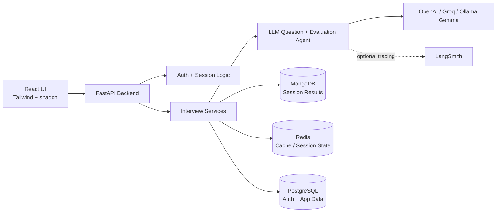

# InterviewBit

InterviewBit is an AI-powered interview assistant designed to help HR teams and hiring managers shortlist candidates more effectively by evaluating technical interview performance using LLM-driven question generation and answer analysis.

## Overview

The platform supports:
- candidate authentication and session tracking
- domain-specific interview practice across multiple technologies
- AI-generated questions based on experience level
- automated evaluation of answers against the question and expected concepts
- detailed candidate feedback and score reports
- containerized local setup with PostgreSQL, MongoDB, Redis, and backend/frontend services

## Project Architecture



## Tech Stack

### Frontend
- React
- Tailwind CSS
- shadcn/ui
- Vite
- Lucide icons

### Backend
- FastAPI
- Pydantic
- JWT authentication
- Redis
- MongoDB
- PostgreSQL
- Docker / Docker Compose

### AI / Agent Layer
- OpenAI models
- Groq models
- Local Ollama models, including Gemma 3 270M
- Optional LangSmith tracing for LangChain runs
- LLM-powered question generation
- LLM-based answer evaluation and scoring

## Implemented Features

### Authentication
- JWT-based authentication
- Register and login flows
- session-based front-end access control
- protected dashboard and interview routes

### Supported Technologies
- Multiple technology categories supported for interview practice
- Different interview tracks can be selected by candidate and role area
- Question generation adapts to the selected technology and candidate experience profile

### LLM Question Generation
- AI-generated interview questions using experience-aware logic
- Questions are adapted depending on beginner, intermediate, and expert-level experience inputs
- OpenAI and Groq question generation can include expected keywords
- Ollama question generation leaves `expected_keywords` optional to keep Gemma output concise

### LLM Evaluator
- Candidate answers are evaluated against the actual question and expected concepts
- Relevance, quality, structure, and completeness are taken into account
- Scoring is not based only on generic answer quality; it is grounded in the question context
- Ollama evaluates the question and answer directly and returns the API's Pydantic-validated response structure

### LangSmith Tracing
- LangChain calls can be traced to a configured LangSmith project using environment variables
- Tracing is optional and controlled by `LANGSMITH_TRACING`
- Traces may contain prompts, model outputs, and candidate answers

### Detailed Evaluation Report
- Per-question score breakdown
- relevance and quality scoring
- coaching feedback
- overall interview summary
- candidate result history and detailed view

## Planned Features

### Authentication Improvements

### Role-Based Access
- recruiter/admin roles
- candidate roles
- different access permissions for dashboards and evaluation workflows

### Voice-Based Interviewing
- spoken interview experience
- voice transcription and analysis
- oral answer scoring and evaluation

## Project Structure

- `backend/` — FastAPI application, API routes, services, DB, and evaluator logic
- `UI/` — React frontend for dashboard, auth, and interview flows
- `data/` — local persistent database volumes for Postgres, Mongo, and Redis
- `docker-compose.yml` — local multi-container orchestration

## Local Setup

Create the backend environment file and add your provider credentials before starting Docker Compose:

```bash
cp backend/.env.example backend/.env
```

### Start the full stack

```bash
docker compose up --build
```

### Run or restart one service

Build one service image and recreate its container without rebuilding the full stack:

```bash
docker compose build backend
docker compose up -d --no-deps backend
```

Replace `backend` with `frontend`, `postgres`, `mongo`, or `redis` to target another service. To restart the existing container without rebuilding its image, or follow that service's logs:

```bash
docker compose restart backend
docker compose logs -f backend
```

### Use Ollama with qwen3.5:9b

Install and start Ollama on the host, then download the model:

```bash
ollama pull qwen3.5:9b
```

Set these values in `backend/.env`:

```dotenv
LLM_PROVIDER=ollama
OLLAMA_MODEL=gemma3:270m
OLLAMA_BASE_URL=http://host.docker.internal:11434/v1
```

The Docker Compose backend uses `host.docker.internal` to connect to Ollama running on the host. When running the backend directly on your machine, use `OLLAMA_BASE_URL=http://localhost:11434/v1`. Restart or rebuild the backend after changing provider settings:

```bash
docker compose up -d --build backend
```

To use a hosted provider instead, set `LLM_PROVIDER=openai` or `LLM_PROVIDER=groq` and configure its API key and model settings in `backend/.env`.

### Enable LangSmith tracing

Set these values in `backend/.env` to send LangChain traces to LangSmith:

```dotenv
LANGSMITH_TRACING=true
LANGSMITH_API_KEY=your-langsmith-api-key
LANGSMITH_PROJECT=InterviewBit
# Optional for a self-hosted or regional LangSmith endpoint
LANGSMITH_ENDPOINT=https://api.smith.langchain.com
```

Set `LANGSMITH_TRACING=false` or leave it unset to disable tracing. Docker Compose passes `backend/.env` to the backend container. Traces can include interview prompts, candidate answers, and model responses, so enable tracing only when that data-sharing is appropriate.

### Stop and clean containers

```bash
docker compose down -v
```

### Reset local database volumes

```bash
rm -rf ./data/postgres ./data/mongo

docker compose up -d
```

### Check service status

```bash
docker compose ps
```

### View logs

```bash
docker compose logs -f postgres
docker compose logs -f backend
docker compose logs -f postgres backend
docker compose restart backend
```

## Health and Verification

### Frontend and backend availability

```bash
curl -I http://localhost:5173
curl -I http://localhost:8000/docs
```

### Database verification

```bash
docker exec -it $(docker compose ps -q postgres) psql -U postgres -l

docker exec -it $(docker compose ps -q postgres) psql -U postgres -d postgres -c "CREATE DATABASE interviewbit;" 

docker exec -it $(docker compose ps -q mongo) mongosh --eval "db.runCommand({ ping: 1 })"
```

> If the PostgreSQL database does not exist, create it with the command above.

## Sample Auth Requests

### Register a user

```bash
curl -X POST http://localhost:8000/api/v1/auth/register \
  -H "Content-Type: application/json" \
  -d '{
    "first_name":"John",
    "last_name":"Doe",
    "phone":"+1234567890",
    "email":"john@example.com",
    "password":"StrongPass123"
  }'
```

### Login a user

```bash
curl -X POST http://localhost:8000/api/v1/auth/login \
  -H "Content-Type: application/json" \
  -d '{
    "email":"john@example.com",
    "password":"StrongPass123"
  }'
```

## Current Product Summary

InterviewBit combines modern full-stack engineering with LLM-assisted interviewing to create a practical AI interview evaluation workflow for candidate screening.

The system currently supports:
- JWT-based authentication
- multiple technology-specific interviews
- AI-generated questions by experience level
- evaluation against expected concepts and question context
- detailed candidate analysis reports
- local containerized deployment via Docker

## Future Vision
 GuarRailss

The roadmap focuses on making the platform more production-ready and scalable with stronger auth security, multi-role access control, and voice-enabled interview experiences for more realistic remote evaluations.
