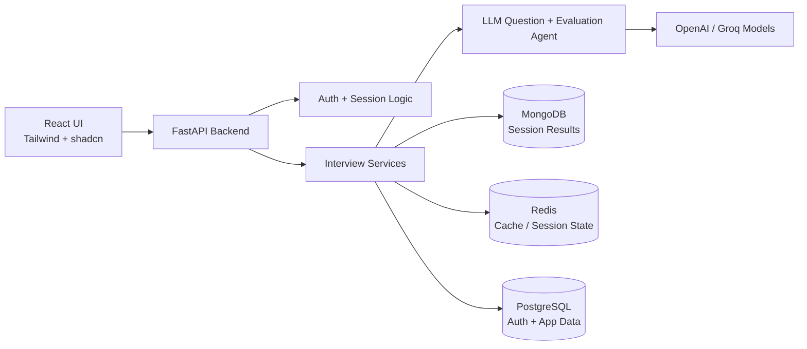

# InterviewBit

InterviewBit is an AI-powered interview assistant designed to help HR teams and hiring managers shortlist candidates more effectively by evaluating technical interview performance using LLM-driven question generation and answer analysis.

## Overview

The platform supports:
- candidate authentication and session tracking
- domain-specific interview practice across multiple technologies
- AI-generated questions based on experience level
- automated evaluation of answers against the question and expected concepts
- detailed candidate feedback and score reports
- containerized local setup with PostgreSQL, MongoDB, Redis, and backend/frontend services

## Project Architecture



## Tech Stack

### Frontend
- React
- Tailwind CSS
- shadcn/ui
- Vite
- Lucide icons

### Backend
- FastAPI
- Pydantic
- JWT authentication
- Redis
- MongoDB
- PostgreSQL
- Docker / Docker Compose

### AI / Agent Layer
- OpenAI models
- Groq models
- LLM-powered question generation
- LLM-based answer evaluation and scoring

## Implemented Features

### Authentication
- JWT-based authentication
- Register and login flows
- session-based front-end access control
- protected dashboard and interview routes

### Supported Technologies
- Multiple technology categories supported for interview practice
- Different interview tracks can be selected by candidate and role area
- Question generation adapts to the selected technology and candidate experience profile

### LLM Question Generation
- AI-generated interview questions using experience-aware logic
- Questions are adapted depending on beginner, intermediate, and expert-level experience inputs
- Questions include expected keywords and evaluation context

### LLM Evaluator
- Candidate answers are evaluated against the actual question and expected concepts
- Relevance, quality, structure, and completeness are taken into account
- Scoring is not based only on generic answer quality; it is grounded in the question context

### Detailed Evaluation Report
- Per-question score breakdown
- relevance and quality scoring
- coaching feedback
- overall interview summary
- candidate result history and detailed view

## Planned Features

### Authentication Improvements
- stronger session security
- refresh token support
- password reset flow
- email verification

### Role-Based Access
- recruiter/admin roles
- candidate roles
- different access permissions for dashboards and evaluation workflows

### Voice-Based Interviewing
- spoken interview experience
- voice transcription and analysis
- oral answer scoring and evaluation

## Project Structure

- `backend/` — FastAPI application, API routes, services, DB, and evaluator logic
- `UI/` — React frontend for dashboard, auth, and interview flows
- `data/` — local persistent database volumes for Postgres, Mongo, and Redis
- `docker-compose.yml` — local multi-container orchestration

## Local Setup

### Start the full stack

```bash
docker compose up --build
```

### Stop and clean containers

```bash
docker compose down -v
```

### Reset local database volumes

```bash
rm -rf ./data/postgres ./data/mongo

docker compose up -d
```

### Check service status

```bash
docker compose ps
```

### View logs

```bash
docker compose logs -f postgres
docker compose logs -f backend
docker compose logs -f postgres backend
docker compose restart backend
```

## Health and Verification

### Frontend and backend availability

```bash
curl -I http://localhost:5173
curl -I http://localhost:8000/docs
```

### Database verification

```bash
docker exec -it $(docker compose ps -q postgres) psql -U postgres -l

docker exec -it $(docker compose ps -q postgres) psql -U postgres -d postgres -c "CREATE DATABASE interviewbit;" 

docker exec -it $(docker compose ps -q mongo) mongosh --eval "db.runCommand({ ping: 1 })"
```

> If the PostgreSQL database does not exist, create it with the command above.

## Sample Auth Requests

### Register a user

```bash
curl -X POST http://localhost:8000/api/v1/auth/register \
  -H "Content-Type: application/json" \
  -d '{
    "first_name":"John",
    "last_name":"Doe",
    "phone":"+1234567890",
    "email":"john@example.com",
    "password":"StrongPass123"
  }'
```

### Login a user

```bash
curl -X POST http://localhost:8000/api/v1/auth/login \
  -H "Content-Type: application/json" \
  -d '{
    "email":"john@example.com",
    "password":"StrongPass123"
  }'
```

## Current Product Summary

InterviewBit combines modern full-stack engineering with LLM-assisted interviewing to create a practical AI interview evaluation workflow for candidate screening.

The system currently supports:
- JWT-based authentication
- multiple technology-specific interviews
- AI-generated questions by experience level
- evaluation against expected concepts and question context
- detailed candidate analysis reports
- local containerized deployment via Docker

## Future Vision

The roadmap focuses on making the platform more production-ready and scalable with stronger auth security, multi-role access control, and voice-enabled interview experiences for more realistic remote evaluations.
